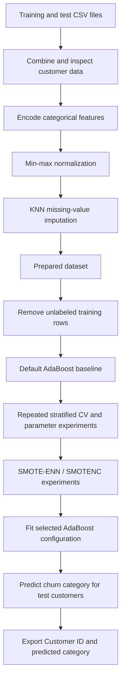

# Customer Churn Prediction with AdaBoost

**Multiclass churn-reason prediction | Data preprocessing | Imbalanced learning | Model tuning**

This project develops a machine-learning workflow to predict **whether a telecommunications customer churns and, if so, the reason for leaving**. It combines customer demographics, service subscriptions, contract details, billing behavior, and satisfaction information with an AdaBoost classifier. The goal is to support more targeted customer-retention analysis rather than treating all churn as one category.

> **Project status:** Exploratory notebook-based analysis. The repository includes the preprocessing and modeling notebooks, but not the underlying CSV datasets or a production inference service. Reported metrics below are notebook outputs, not independently reproduced benchmark results.

## At a glance

| Item | Details |
| --- | --- |
| Problem | Multiclass classification of customer churn reasons |
| Model | AdaBoost with decision-tree base learners |
| Data preparation | Categorical encoding, min–max scaling, 5-neighbor KNN imputation |
| Imbalance experiments | SMOTE-ENN and SMOTENC |
| Evaluation | Repeated stratified cross-validation; accuracy, macro recall/F1, and churn-only recall/F1 in tuning code |
| Recorded baseline | **0.809 ± 0.007 cross-validation accuracy** for default AdaBoost (10 folds × 3 repeats) |
| Environment | Python / Jupyter Notebook; Google Colab paths in modeling notebook |

## Business question

Customer churn can have different causes: customers may leave for a competitor, because of dissatisfaction, price, attitude, or other reasons. Predicting **churn categories** could help a telecom business prioritize investigation and tailor retention strategies. This repository explores that classification problem; it does **not** measure the impact of any deployed retention campaign.

## Data and target

The preprocessing notebook reads two source CSVs (a training file and a test file), concatenates them, and processes **7,043 customer records**. The modeling notebook subsequently uses the first **5,634** rows as its training partition and the remaining **1,409** as its prediction partition. Some training records have no target label and are removed before supervised training.

The target is `Churn Category`, encoded as:

| Code | Churn category |
| --- | --- |
| 0 | No Churn |
| 1 | Competitor |
| 2 | Dissatisfaction |
| 3 | Attitude |
| 4 | Price |
| 5 | Other |

The preprocessing notebook prints the following **non-missing label counts** before modeling: No Churn 3,118; Competitor 490; Attitude 201; Dissatisfaction 177; Price 124; Other 116. These counts illustrate substantial class imbalance and **do not include unlabeled rows**.

Features include age, dependents, tenure, contract, internet service, payment method, monthly charges, revenue, referrals, and satisfaction score. Customer ID is retained for identifying output records but excluded from the model features.

> **Data availability:** Source CSV files and the generated `missing_treated_v2.csv` used by the modeling notebook are **not committed** to this repository. You will need your own authorized copies and must update file paths to run the notebooks. Do not publish customer-level data without permission.

## Analytical workflow



### 1. Preprocessing — `data_preprocessing.ipynb`

- Combines the source training and test data.
- Removes columns identified as unnecessary in the notebook.
- Encodes categorical predictors: label encoding for variables with at most three unique values; relative-frequency encoding for variables with more categories.
- Encodes the churn-category target as integers 0–5.
- Applies min–max scaling to numeric columns.
- Uses `KNNImputer(n_neighbors=5)` to fill missing predictor values.
- Exports a prepared CSV named `missing_treated.csv`.

**Important reproducibility note:** The modeling notebook reads `missing_treated_v2.csv`, not `missing_treated.csv`. Confirm which prepared file/version you intend to use before running the modeling steps.

### 2. Modeling — `Churn_Prediction_AdaBoost.ipynb`

- Separates the prepared data into training and unlabeled prediction partitions.
- Removes unlabeled training records for supervised learning.
- Evaluates default `AdaBoostClassifier` using repeated stratified cross-validation.
- Explores `n_estimators` (30, 50, 100, 150, 200), `learning_rate` (0.01, 0.05, 0.1, 0.3, 0.5), and decision-tree depths (1, 3, 5, 7, 10): **125 configurations** in the explicit tuning loop.
- Defines custom metrics focused on the churn classes (1–4 in the code); note that class **5 (`Other`) is not included** in those custom churn-only metrics.
- Experiments with both SMOTE-ENN and SMOTENC to address class imbalance.
- Fits a final AdaBoost configuration with **100 estimators**, **learning rate 0.3**, and a **depth-1 decision tree**, then exports customer IDs and predicted churn categories to CSV.

## Results and interpretation

The notebook contains this recorded result for **default AdaBoost**:

| Evaluation | Recorded result |
| --- | --- |
| Repeated stratified 10-fold CV × 3 | **Accuracy: 0.809 (standard deviation: 0.007)** |

This is a **baseline cross-validation score**, not a verified held-out test accuracy for the final oversampled model. The repository explores resampling and tuning, but does not provide a complete, clearly documented held-out comparison establishing that either technique improved final generalization. In an imbalanced multiclass problem, accuracy alone can obscure poor detection of less common churn reasons; per-class precision, recall, F1, and a confusion matrix would be valuable additions.

## Repository structure

```text
Customer-Churn-Prediction/
├── README.md
├── data_preprocessing.ipynb       # Encoding, normalization, missing-data treatment
└── Churn_Prediction_AdaBoost.ipynb # AdaBoost, CV, resampling, predictions
```

## How to run

1. Clone the repository and open the notebooks in Jupyter or Google Colab.
2. Install the Python dependencies used by the notebooks:

   ```bash
   pip install pandas numpy scikit-learn imbalanced-learn tqdm jupyter
   ```

3. Obtain the original training and test CSVs through an authorized source, then update the input paths in `data_preprocessing.ipynb`.
4. Run the preprocessing notebook. Check its output filename and align it with the file expected by `Churn_Prediction_AdaBoost.ipynb`.
5. Update the Google Drive input path and local CSV export path in the modeling notebook, then execute its cells in order.
6. Review the final CSV containing `Customer ID` and `Churn Category` predictions.

**Compatibility:** The notebooks contain environment-specific absolute paths, deprecated NumPy usage (`np.int`), and both `estimator=` and `base_estimator=` AdaBoost parameter styles. Depending on your installed scikit-learn/NumPy versions, you may need to update these calls. The repository does not pin a tested dependency environment.

## Limitations and next steps

- **Leakage-safe evaluation:** Fit encoders, scalers, and imputers only on training folds; the preprocessing notebook currently combines training and test records before fitting transformations. Keep resampling inside each training fold when comparing models.
- **Class imbalance:** Compare per-class F1/recall and macro-averaged metrics, especially for less common churn categories; clarify whether `Other` should be included in churn-only scoring.
- **Independent validation:** Establish a held-out labeled test set and report a confusion matrix and a consistent baseline-versus-resampling comparison.
- **Reproducibility:** Align the preprocessing output filename with the modeling input, replace absolute paths, pin dependency versions, and document data access.
- **Model comparison:** Explore alternatives such as XGBoost or CatBoost and assess probability calibration before operational use.

## Tech stack

**Python · pandas · NumPy · scikit-learn · imbalanced-learn · Jupyter Notebook · Google Colab · tqdm**

## Disclaimer

This is an exploratory machine-learning project. Predictions are not a substitute for customer research, validation on representative current data, or assessment of privacy and fairness before business deployment.
